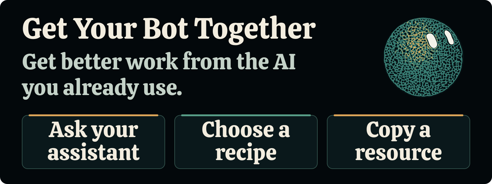
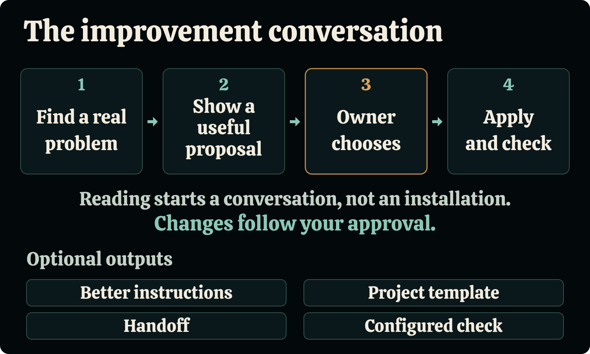

# Get Your Bot Together

**Get better work from the AI you already use.**

Give your assistant this page. Together, find a task that keeps taking too much effort, choose a useful improvement, and put it to work.

Start with a Grok Bot, ChatGPT Dot, Muse, Duet, or an ordinary chat. Borrow a short procedure, organize a project, improve a handoff, or add a configured worker when the job benefits from one.

**[Start a useful conversation](START-HERE.md)** · **[Browse the recipes](recipes/README.md)** · **[Copy a template](templates/README.md)**

Read the companion article: [AI Agent vs. AI Assistant: How Much Control Do You Have?](https://brennanflentge.com/blog/ai-agent-vs-ai-assistant-control/).

## Ask your assistant

Copy this into the conversation where you already do the work, along with this page's link:

> Use Get Your Bot Together to help improve one task we do together. Read START-HERE.md and the relevant recipe. Look at recent work you can actually access; ask me for one example if you need it. Explain a few useful improvements in plain English and recommend one. Show the exact proposed wording, files, or settings and how we would check the result. Ask before applying changes or launching additional work. Use what I already have.

On X, reply to the article with:

> @bot Read this article and the linked Get Your Bot Together repository. Help me find one useful improvement to how we work together. Show me the proposed setup first.

[verified — Grok documentation] Eligible linked accounts can [forward an @bot request](https://docs.x.ai/grok-bot/tag-on-x) to their main Bot. Open the Bot app to continue. You can also paste this page into a chat. Keep personal work and account details in that private conversation.

## What would help you?

| Something you recognize | What you can leave with |
|---|---|
| “I keep correcting the same mistake.” | [One change that addresses the recurring problem](recipes/repeated-mistakes.md) |
| “It loses track of the project.” | [A short project home and clear instructions](recipes/project-home.md) |
| “Find where I actually said that.” | [An exact-quote source finder](recipes/find-my-words.md) |
| “Check this against what I asked for.” | [A focused review of the actual work](recipes/check-the-work.md) |
| “Another chat needs to pick this up.” | [A handoff with the current files and corrections](recipes/handoff.md) |
| “I do this every week.” | [A reusable procedure](recipes/repeatable-work.md) |
| “Check the numbers before I use them.” | [A working report checker and example data](recipes/check-a-report.md) |
| “Prepare it, then let me decide.” | [A complete draft and a deliberate finish](workflows/draft-to-finish.md) |
| “Make a useful check happen automatically.” | [Small, scoped hook examples](recipes/useful-hooks.md) |

## See a complete example

A newsletter writer keeps receiving drafts with missing source links. The assistant proposes a short writing procedure and a source table, explains where they would live, and shows a check using a deliberately unsupported claim.

The writer can use the procedure in the current chat. They can also approve saving it for future work. A separate worker becomes useful when it brings specific tools, source access, or repeatable checks.

[Read the example conversation](examples/newsletter-session.md) · [Try the report checker](recipes/check-a-report.md)

### The improvement conversation

1. Find a real problem.
2. Show a useful proposal.
3. Owner chooses.
4. Apply and check.

Choose an output that helps your task: better instructions, a project template, a handoff, or a configured check.

<picture>
  <source media="(max-width: 600px)" srcset="assets/readme/improvement-flow-stacked.png">
  
</picture>

[Wide diagram](assets/readme/improvement-flow-wide.svg) · [Stacked diagram](assets/readme/improvement-flow-stacked.svg)

## Use your existing tools

**Your assistant:** [Grok Bot](products/grok.md) · [ChatGPT Dot](products/dot.md) · [Muse](products/muse.md) · [Claude Duet](products/duet.md)

**A configured worker:** [Claude Code](runtimes/claude-code.md) · [Codex](runtimes/codex.md) · [Cursor](runtimes/cursor.md) · [Grok Build](runtimes/grok-build.md)

**Reusable roles:** [Source finder](agents/source-finder.md) · [Reviewer](agents/reviewer.md) · [Finisher](setup/finish-work.md)

You can begin with a conversation and one example. Downloading files becomes useful when you choose to use the scripts or copy resources into a project.

## Know what a change does

An instruction describes how you want the assistant to work. A permission controls access through a particular service. A check evaluates a defined condition. A hook runs code at a supported event. Each recipe names the part it changes and gives you a way to inspect the result.

Reading this repository starts a discussion. Your approval determines which proposed changes get applied.

[Sources and supported scope](SOURCES.md) · [Checks and examples](TESTING.md) · [Contributing](CONTRIBUTING.md)

Code, templates, and documentation are available under the [MIT License](LICENSE).
